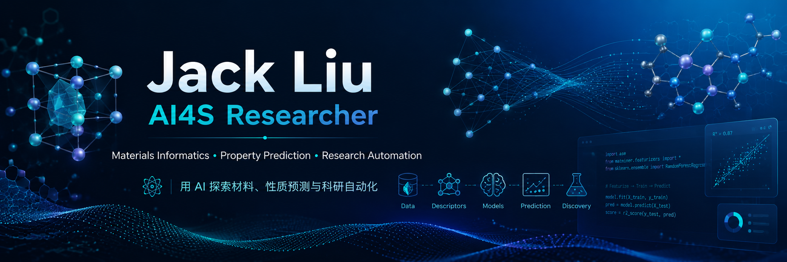

  

  

  
  
  

## Hi, 我是 Jack Liu (Yujie Liu)

我来自**西安交通大学材料科学与工程学院 / 金属材料强度国家重点实验室**，长期关注 **AI4S (AI for Science)**、**Materials Informatics (材料信息学)** 与 **科研自动化 / LLM Agent**。致力于将机器学习、深度学习与大语言模型引入真实材料物理与化学问题中，涵盖材料性质预测、逆向设计、少样本学习与自主科学发现。

- 🎓 **单位**：西安交通大学 金属材料强度国家重点实验室 / 材料科学与工程学院
- 🔬 **研究方向**：AI for Science、材料信息学 (Materials Informatics)、LLM Agent、数据驱动材料设计
- 🛠️ **主要工具**：Python、PyTorch、Transformers、scikit-learn、Pandas、Jupyter、Electron
- 🌐 **学术主页**：[Google Scholar Profile](https://scholar.google.com/citations?hl=en&user=jOu_s-sAAAAJ)

## Tech Stack

  

  
  
  
  
  
  
  

## 📄 Selected Publications

> 更多学术发表与引用统计请查阅 [Google Scholar Profile](https://scholar.google.com/citations?hl=en&user=jOu_s-sAAAAJ)。

1. **LLM-Assisted Design of Ultralow-κ Chalcogenides** 🔥 *(Latest)*  
   **Yujie Liu**, Congran Jia, Yuzhou Hao, Xuejie Li, Yang Wang, Artem R. Oganov, Jun Sun, Xiangdong Ding, Turab Lookman\*, Zhibin Gao\*  
   *Advanced Science*, 2026.  
   
   

2. **Materials Informatics: Emergence to Autonomous Discovery in the Age of AI**  
   Turab Lookman\*, **Yujie Liu**, Zhibin Gao\*  
   *Advanced Materials*, 38 (29), e15941, 2026.  
   
   

3. **PINK: Physical-informed Machine Learning for Lattice Thermal Conductivity**  
   **Yujie Liu**, Xiaoying Wang, Yuzhou Hao, Xuejie Li, Jun Sun, Turab Lookman, Xiangdong Ding, Zhibin Gao\*  
   *arXiv preprint*, arXiv:2503.17060, 2025.  
   
   

4. **LLM-Driven Discovery for Carbon Allotropes with Bond-Network Entropy**  
   Yuzhou Hao, **Yujie Liu**, Xuejie Li, Turab Lookman, Xiangdong Ding, Jun Sun, Zhibin Gao\*  
   *Applied Physics Letters*, 128 (10), 102202, 2026.  
   
   

5. **Machine Learning-Driven Elasticity Prediction in Advanced Inorganic Materials via Convolutional Neural Networks**  
   **Yujie Liu**, Zhenyu Wang, Hang Lei, Guoyu Zhang, Jiawei Xian, Zhibin Gao, Jun Sun, Haifeng Song, Xiangdong Ding\*  
   *Acta Physica Sinica*, 74 (12), 2025.  
   
   

6. **Same-Group Element Replacement Enhances Superconductivity in Clathrate-Like YH4**  
   Xuejie Li, Yuzhou Hao, **Yujie Liu**, Xiaoying Wang, Turab Lookman, Jun Sun, Xiangdong Ding, Zhibin Gao\*  
   *The Journal of Chemical Physics*, 163 (10), 104107, 2025.  
   
   

7. **Strain-Engineering the Lattice Thermal Conductivity of 2D Kagome Silica**  
   Yang Wang, Xiaoying Wang, Yuzhou Hao, Xuejie Li, **Yujie Liu**, Jun Sun, Xiangdong Ding, Zhibin Gao\*  
   *Applied Physics Letters*, 126 (7), 072202, 2025.  
   
   

## Featured Projects

<table>
  <tr>
    <td width="50%">
      <h3 align="center">Personal Research Workbench</h3>
      
本地优先的科研工作台桌面应用：集成任务看板、日程规划、文献检索、Obsidian/Zotero 联动与 AI 辅助写作。

      

        
      

    </td>
    <td width="50%">
      <h3 align="center">AI4Kappa</h3>
      
围绕晶格热导率预测的物理知情机器学习（PINK）开源实现与 AI4S 实践。

      

        
      

    </td>
  </tr>
  <tr>
    <td width="50%">
      <h3 align="center">Auto_Discover_LowThermalConductivity_Materials</h3>
      
自动化低热导材料发现工作流（ADLM），结合贝叶斯优化、LLM 智能筛选与物理性质预测。

      

        
      

    </td>
    <td width="50%">
      <h3 align="center">ResearchMind</h3>
      
面向材料科学与科研场景的 LLM 智能体，辅助文献洞察、实验设计与假设验证。

      

        
      

    </td>
  </tr>
</table>

## GitHub Analytics

  
  
  

## Contribution Graph

  <picture>
    <source media="(prefers-color-scheme: dark)" srcset="https://raw.githubusercontent.com/Jack-Liu0227/Jack-Liu0227/output/github-contribution-grid-snake-dark.svg" />
    <source media="(prefers-color-scheme: light)" srcset="https://raw.githubusercontent.com/Jack-Liu0227/Jack-Liu0227/output/github-contribution-grid-snake.svg" />
    
  </picture>

---

  <strong>用 AI 探索材料、性质预测与科研自动化。</strong>
   
  <a href="mailto:2802644093@qq.com">Email</a>
  ·
  <a href="https://github.com/Jack-Liu0227">GitHub</a>
  ·
  <a href="https://scholar.google.com/citations?hl=en&user=jOu_s-sAAAAJ">Google Scholar</a>

